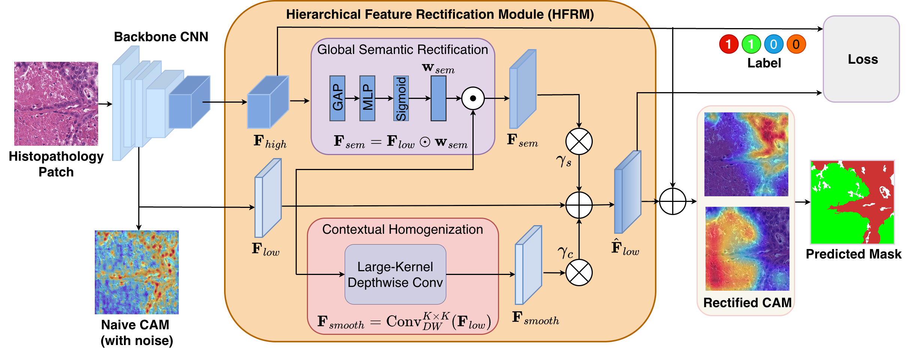

# SSHR: Single-Stage Hierarchical Rectification for Weakly Supervised Histopathology Segmentation (MICCAI 2026)

## Abstract
  <details>
  <summary>Click to expand</summary>

Existing weakly supervised semantic segmentation (WSSS) methods in computational pathology rely on a multi-stage paradigm: class activation map (CAM) generation, offline pseudo-mask refinement, and fully supervised retraining. While established, this decoupled approach presents fundamental limitations. The multi-stage process not only incurs high computational training costs but also suffers from error propagation: local texture biases in shallow CNN layers generate false-positive artifacts that subsequent refinement steps often fail to correct.

To address these persistent challenges through a simple yet highly effective approach, we propose the Single-Stage Hierarchical Rectification (SSHR) framework. Rather than passively refining CAMs post-hoc, our method proactively purifies intermediate feature representations during the forward pass. We introduce a Hierarchical Feature Rectification Module (HFRM) that utilizes deep global semantic context to filter out local anomalies in shallow layers. This mechanism generates high-fidelity activation maps directly within a single training loop.

Experiments on the LUAD-HistoSeg and BCSS datasets demonstrate that SSHR outperforms state-of-the-art multi-stage methods. Furthermore, SSHR reduces training duration by 2 to 5 times. This efficiency minimizes computational overhead and accelerates clinical translation for large-scale histopathology workflows.

**Keywords:** Weakly supervised learning, semantic segmentation, computational pathology, single-stage learning.

  </details>

## Framework


<p align="center">
  
</p>

## Directory Structure

```text
SSHR/
├── datasets/
│   ├── BCSS-WSSS/
│   │   ├── training/          # training images with image-level labels in filenames
│   │   ├── val/
│   │   │   ├── img/
│   │   │   └── mask/
│   │   └── test/
│   │       ├── img/
│   │       └── mask/
│   └── LUAD-HistoSeg/
│       ├── training/          # training images with image-level labels in filenames
│       ├── val/
│       │   ├── img/
│       │   └── mask/
│       └── test/
│           ├── img/
│           └── mask/
├── init_weights/              # pretrained initialization weights, ignored by git
└── checkpoints/               # training checkpoints, ignored by git
```


## Usage

### Step 1: Download Data and Weights

Download the pretrained classification initialization weight:

- [ImageNet initialization weight](https://drive.google.com/file/d/1Rka2SzqAwxUEFb28tbmiy2anhkkFOnTg/view?usp=drive_link)

Download the datasets:

- [LUAD-HistoSeg dataset](https://drive.google.com/file/d/1lWAeCp6UN30VRVmqv97kA2sJ1Pp2frhC/view?usp=drive_link)
- [BCSS-WSSS dataset](https://drive.google.com/file/d/178eSM9xs5jITt5P2kjaswDlJzwlU5gps/view?usp=drive_link)

Place the initialization weight at:

```text
init_weights/ilsvrc-cls_rna-a1_cls1000_ep-0001.params
```

Place the datasets under `datasets/` following the structure above.

### Step 2: Setup Environment

```bash
conda create -n sshr python=3.10 -y
conda activate sshr
pip install -r requirements.txt
pip install mxnet==1.9.1
pip install numpy==1.23.5
```


### Step 3: Train and Evaluate

Use the supported commands in the [Reproducibility Protocol](#reproducibility-protocol) below.

## Acknowledgement

We thank the authors of [ESFAN](https://github.com/OceanPetal/ESFAN), whose codebase provided a valuable foundation for this repository.


## Reproducibility Protocol

The current repository revision is the supported protocol for new SSHR reproductions. It has no hidden preprocessing or post-processing stages.

### Fixed Settings

- HFRM context kernel: `K=15`.
- Initialization: `init_weights/ilsvrc-cls_rna-a1_cls1000_ep-0001.params`.
- Image size: `224 x 224`; ImageNet normalization is used for training and inference.
- Training augmentation: independent horizontal and vertical flips, each with probability `0.5`. No other augmentation is applied in the stage-1 training path.
- Training precision: BF16 AMP. cuDNN benchmarking and TF32 are enabled for throughput, so matching seeds are not expected to be bitwise deterministic across hardware or PyTorch versions.
- Inference: TTA is always enabled using the original image, horizontal flip, and vertical flip. BCSS uses foreground thresholds `[0.8, 0.9, 0.8, 0.6]`; LUAD uses `0.2` for each foreground class.
- Checkpoint rule: train for 25 epochs and report `stage1_epoch_0025.pth`. Do not select a checkpoint using validation mIoU.

### Training Commands

Set `DATA_ROOT` so that it contains `BCSS/{train,val,test}` and `LUAD/{train,val,test}`. Run the three seeds `11`, `17`, and `42` separately through Slurm. The following command performs no validation or test inference during training and writes only the epoch-24 and epoch-25 checkpoints.

```bash
DATASET=luad      # use bcss for BCSS
DATASET_DIR=LUAD  # use BCSS for BCSS
SEED=11          # run 11, 17, and 42

python train_sshr.py \
  --dataset "${DATASET}" \
  --seed "${SEED}" \
  --max_epoches 25 \
  --weights init_weights/ilsvrc-cls_rna-a1_cls1000_ep-0001.params \
  --trainroot "${DATA_ROOT}/${DATASET_DIR}/train" \
  --save_folder "checkpoints_${DATASET}_seed${SEED}_25ep" \
  --eval_every 0 \
  --no-save-checkpoints \
  --save-last-k-checkpoints 2 \
  --n_class 4 \
  --img_size 224 \
  --num_workers 4 \
  --amp-dtype bf16
```

### Test Evaluation

TTA is applied automatically by the main inference path. Evaluate the final epoch-25 checkpoint as follows:

```bash
python train_sshr.py \
  --evaluate-only \
  --dataset luad \
  --seed 11 \
  --weights checkpoints_luad_seed11_25ep/stage1_epoch_0025.pth \
  --testroot "${DATA_ROOT}/LUAD/test" \
  --n_class 4 \
  --img_size 224 \
  --num_workers 4 \
  --amp-dtype bf16
```

### Optimizer Clarification

`PolyOptimizer` uses a polynomial learning-rate schedule with power `0.9`. For compatibility with the released recipe, the scalar `--wt_dec` value (default `5e-4`) is the effective SGD momentum. The parameter groups in `train_sshr.py` carry their own weight-decay values (`5e-4` for groups 0 and 2, and `0` for groups 1 and 3). The implementation uses named SGD arguments to make this legacy behavior explicit.

### H100 Re-run (Three Seeds)

The following TTA test metrics were obtained on an H100 server using seeds `11`, `17`, and `42`, the 25-epoch checkpoint rule above, and sample standard deviation across seeds:

| Dataset | Mean IoU | Mean Dice |
| --- | --- | --- |
| BCSS | `70.26 +/- 0.09` | `82.33 +/- 0.07` |
| LUAD-HistoSeg | `77.51 +/- 0.22` | `87.28 +/- 0.14` |
